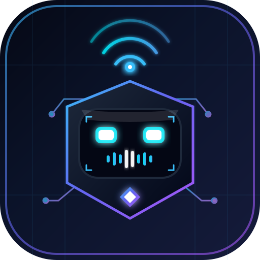

# 📱 BotHub Pro (MobileRemoteControlBot)

> **Единый мобильный пульт управления ботами-помощниками для организаций, клиентский биллинг и агентский ИИ-копайлот.**

<p align="center">
  
</p>

[](https://github.com/pippopil/MobileRemoteControlBot/actions/workflows/build-android-release.yml)
[](https://github.com/pippopil/MobileRemoteControlBot/releases)
[](https://github.com/pippopil/MobileRemoteControlBot)
[](https://github.com/pippopil/MobileRemoteControlBot)
[](LICENSE)

---

## 🌟 Что такое BotHub Pro

**BotHub Pro** — это автономное приложение-пульт, созданное специально для специалистов и агентств по автоматизации бизнеса. 

С помощью одного экрана на мобильном телефоне вы управляете ботами-помощниками десятков организаций:
* 🛞 **Автосервисы и шиномонтажи** (запись на подъемник, расчет радиуса колес R13–R22, сезонное хранение шин).
* 💈 **Салоны красоты и барбершопы** (выбор мастера, свободные слоты, напоминания о визите).
* 🦷 **Стоматологии и медклиники** (первичный осмотр, сбор симптомов, запись к профильному врачу).
* 🍕 **Рестораны и доставка еды** (меню, прием заказов, адрес доставки, бронь столов).
* ⚖️ **Юридические бюро и недвижимость** (квалификация лидов, скоринг платежеспособности, запись на консультацию).

### 💰 Бизнес-модель: как зарабатывать на BotHub Pro
1. **Setup Fee (Разовый чек за внедрение)**: 15 000 – 30 000 ₽ с каждого нового клиента за первоначальную настройку промпта, прайс-листа и запуск бота.
2. **MRR (Monthly Recurring Revenue / Ежемесячная абонплата)**: 3 500 – 7 900 ₽/мес с каждой организации за поддержание работы серверов, обновление прайс-листов и консультации.
3. При базе всего из **15 клиентов** ваш стабильный ежемесячный доход составляет **60 000 – 100 000 ₽/мес**, требуя минимум времени на сопровождение через мобильный пульт.

---

## 📖 Полное пошаговое руководство: как пользоваться и подключать клиентов

Ниже представлена детальная инструкция от создания Telegram-бота до получения первой абонентской платы.

```
┌─────────────────┐     ┌─────────────────┐     ┌─────────────────┐     ┌─────────────────┐
│     Шаг 1       │     │     Шаг 2       │     │     Шаг 3       │     │     Шаг 4       │
│  @BotFather     │ ──> │   BotHub Pro    │ ──> │   AI & Прайс    │ ──> │  Тест диалога   │
│ Создание токена │     │ Добавление бота │     │ Генерация мозга │     │  В симуляторе   │
└─────────────────┘     └─────────────────┘     └─────────────────┘     └─────────────────┘
                                                                                 │
                                                                                 ▼
                                                                        ┌─────────────────┐
                                                                        │     Шаг 5       │
                                                                        │ Сдача клиенту   │
                                                                        │  + Сбор MRR ₽   │
                                                                        └─────────────────┘
```

---

### 🔑 Шаг 1. Создание бота в Telegram через @BotFather (2 минуты)

Все официальные боты Telegram регистрируются через системного бота мессенджера — **@BotFather**. Это бесплатно и занимает ровно 2 минуты.

1. Откройте Telegram на телефоне или компьютере.
2. В строке поиска найдите `@BotFather` (официальный бот с синей галочкой) или перейдите по прямой ссылке: [t.me/BotFather](https://t.me/BotFather).
3. Нажмите кнопку **Запустить** (или отправьте команду `/start`).
4. Отправьте команду создания нового бота:
   ```text
   /newbot
   ```
5. **Имя бота**: BotFather спросит отображаемое имя компании. Введите понятное название на русском языке:
   * Например: `Шиномонтаж 24/7 Сервис` или `Стоматология ДентаЛюкс`.
6. **Юзернейм бота**: BotFather попросит указать уникальный латинский username, который **обязательно заканчивается на `bot`**:
   * Например: `shina24_express_bot` или `dentalux_clinic_bot`.
7. **Получение API Токена**: BotFather поздравит вас с созданием бота и пришлёт сообщение с токеном вида:
   ```text
   7128394851:AAFpL89Qz_xY81290KmnOPqrStuVwXyZ123
   ```
8. **Скопируйте этот токен** в буфер обмена телефона — он понадобится на следующем шаге.

---

### ➕ Шаг 2. Добавление организации в пульт BotHub Pro (2 минуты)

1. Откройте приложение **BotHub Pro** на телефоне (через PWA или APK) или на компьютере.
2. В нижнем навигационном меню нажмите **«Новый бот»** (или зелёную кнопку **«+ Добавить бота»** на главном экране).
3. Заполните данные организации:
   * **Выбор ниши**: нажмите на подходящую категорию (Автосервис, Красота, Медицина, Ресторан, Юристы). Система автоматически подставит рыночный средний чек абонплаты.
   * **Название организации**: например, `Шиномонтаж «АвтоЛидер 24»`.
   * **Телефон организации**: номер дежурного мастера или администратора (на него бот будет отправлять клиентов при нестандартных вопросах).
   * **Контактное лицо**: имя владельца бизнеса или управляющего (например: `Алексей (Управляющий)`).
   * **Каналы связи**: выберите каналы (Telegram, МАКС, WhatsApp, VK).
   * **Токен Telegram**: вставьте скопированный из @BotFather API-токен.
   * **Тариф и абонплата**: укажите сумму ежемесячной поддержки (например, `4 900 ₽/мес`) и стоимость разового внедрения (`19 900 ₽`).
4. Нажмите кнопку **«Далее: Настройка AI-мозга»**.

---

### 🧠 Шаг 3. Настройка AI-мозга, услуг и прайс-листа (3 минуты)

Главная ценность вашего бота для заказчика — это то, что бот знает точный прайс-лист, умеет вежливо консультировать и за 20 секунд оформляет запись без звонков.

1. **Генерация конфигурации в 1 клик через AI**:
   * В окне конструктора нажмите синюю кнопку с иконкой искр: **«Сгенерировать AI-конфигурацию»**.
   * Встроенная нейросеть Gemini автоматически составит:
     - Приветственное сообщение бота с эмодзи (показывается при нажатии `/start`).
     - Детальный системный промпт (роль цифрового администратора, вежливый тон, правила сбора контактов).
     - Перечень из 4–6 услуг с рыночными ценами в рублях.
     - Частые вопросы и ответы (FAQ).
2. **Корректировка прайса**:
   * Отредактируйте названия услуг и цены под реальный прейскурант заказчика (например: *«Комплексный шиномонтаж R16 — 2 200 ₽»*).
   * Добавьте телефон и адрес компании.
3. Нажмите кнопку **«Сохранить и запустить бота»**.

Бот моментально появится в вашем списке подключенных клиентов!

---

### 💬 Шаг 4. Тестирование диалога в симуляторе прямо с телефона (2 минуты)

Перед передачей бота заказчику проверьте его работу через встроенный интерактивный симулятор:

1. В списке клиентов нажмите кнопку **«Тест диалога»** на карточке нужной организации.
2. Откроется симулятор реального чата Telegram:
   * Бот поздоровается фирменным приветствием компании.
   * Задайте вопрос от лица клиента:
     > *«Сколько стоит переобуть 4 колеса на 17 радиус?»*
   * Бот мгновенно найдет услугу в прайс-листе и назовет точную цену.
   * Напишите:
     > *«Можно записаться на завтра в 16:30?»*
   * Бот зафиксирует желаемое время и вежливо попросит номер телефона и имя для подтверждения бронирования.
3. Если нужно изменить текст или добавить услугу — перейдите во вкладку **«База знаний»** в том же окне и отредактируйте промпт или прайс на лету. Изменения сохраняются мгновенно.

---

### 🤝 Шаг 5. Передача заказчику и настройка ежемесячной абонплаты

1. **Передача ссылки заказчику**:
   * Отправьте владельцу бизнеса ссылку на бота: `https://t.me/ваш_бот_bot`.
   * Попросите его и администраторов протестировать запись со своих смартфонов.
2. **Получение разового чека за настройку (Setup Fee)**:
   * Выставите счет на 15 000 – 25 000 ₽ за настройку системы под ключ.
3. **Ежемесячный биллинг (MRR)**:
   * Во вкладке **«Финансы»** вашего пульта автоматически рассчитывается общий доход и отображается календарь платежей.
   * За 3–5 дней до даты списания карточка клиента подсвечивается желтым статусом `🟡 Требует оплаты`.
   * Нажмите на карточку клиента и скопируйте готовый шаблон напоминания об оплате:
     ```text
     Здравствуйте, [Имя клиента]!
     Напоминаем, что срок оплаченного периода обслуживания вашего Telegram-бота подходит к концу ([Дата]).
     Сумма ежемесячной поддержки: 4 900 ₽.
     В абонплату входит:
     • Бесперебойная работа серверов 24/7
     • Обновление прайса и акций по вашему запросу
     • Прием и учет заявок без перерывов и выходных
     Реквизиты: [Номер карты / СБП].
     ```
   * После подтверждения перевода нажмите значок **`$`** на карточке клиента в пульте — система автоматически продлит подписку на 30 дней и вернёт зеленый статус `🟢 Онлайн`.

---

## 🎯 Скрипты продаж: как предлагать бота клиентам с высокой конверсией

Во вкладке **«Наш бот»** встроен ваш персональный ИИ-ассистент, который в любую секунду генерирует коммерческие предложения (КП), скрипты и ответы на любые возражения.

### Готовый шаблон сообщения в WhatsApp/Telegram руководителю:
```text
«Здравствуйте, [Имя руководителя]! Нашел вашу компанию на Яндекс.Картах.
Мы разработали умного Telegram-бота для вашей сферы, который за 1 секунду отвечает клиентам 24/7, рассчитывает стоимость по прайсу и записывает на свободное время прямо в чате без звонков.

Готов подключить вам бесплатный тест-драйв на 3 дня на пробу — посмотрите, сколько ночных и утренних заявок он перехватит.
Интересно прислать 1-минутную ссылку на демо-бота?»
```

### Отработка главного возражения: *«У нас уже есть администратор, бот не нужен»*
> *«[Имя], администратор — ключевой человек для встречи гостей в зале. Но ночью в 23:00 или в пиковый наплыв он физически не успевает ответить новому клиенту за 1–2 минуты. За это время клиент уходит к конкурентам.*  
> *Бот не заменяет человека, а берет на себя 80% рутины: ответы на "Сколько стоит?", график работы и первичную запись. Админ занимается сервисом и деньгами, а бот ловит заявки 24/7. Давайте включим демо на 3 дня бесплатно?»*

---

## 📲 Установка PWA (Progressive Web App) на устройства

PWA превращает веб-версию в автономное мобильное приложение без магазинов App Store и Google Play.

### 🍏 На iPhone и iPad (iOS через Safari)
1. Откройте ссылку на BotHub Pro в браузере **Safari**.
2. Внизу нажмите кнопку **«Поделиться»** (квадрат со стрелкой вверх `[↑]`).
3. Выберите пункт **«На экран "Домой"»** (*Add to Home Screen*).
4. Нажмите **«Добавить»** в правом верхнем углу.

### 🤖 На Android (Chrome, Яндекс, Samsung Internet)
1. Откройте ссылку в браузере мобильного телефона.
2. Откройте меню браузера (кнопка `⋮` с тремя точками в верхнем или нижнем углу).
3. Нажмите **«Установить приложение»** (или **«Добавить на главный экран»**).
4. Подтвердите установку. Иконка BotHub Pro появится на рабочем столе смартфона и приложение будет открываться автономно на весь экран как нативное мобильное приложение.

### 💻 На компьютере (Windows, macOS, Linux)
1. Откройте приложение в Chrome, Edge или Яндекс.Браузере.
2. В правой части адресной строки нажмите значок монитора со стрелкой: **«Установить приложение BotHub Pro»** (`⊕`).

---

## 🤖 Нативное Android-приложение (APK v1.0.8)

Для максимальной стабильности на смартфонах Android доступен готовый установочный файл APK:
* **Страница релизов**: [GitHub Releases](https://github.com/pippopil/MobileRemoteControlBot/releases)
* **Прямая ссылка на APK**: [**MobileRemoteControlBot-v1.0.8.apk**](https://github.com/pippopil/MobileRemoteControlBot/releases/download/v1.0.8/MobileRemoteControlBot-v1.0.8.apk) (5.09 МБ)

### Особенности версии v1.0.8:
- ✅ Устранены все вылеты на рабочий стол и проблемы чёрного экрана.
- ✅ Полная совместимость с Android 7.0–15 (API 24–35).
- ✅ Автономная работа WebView с кэшированием всех ассетов локально внутри APK.
- ✅ Поддержка фоновых уведомлений и сохранения состояния клиентов.

---

## 🛠 Стек технологий

- **Клиент**: React 19, TypeScript, Vite, Tailwind CSS v4, Lucide React.
- **PWA**: `vite-plugin-pwa`, Workbox, Web App Manifest.
- **Android**: Kotlin, Android SDK 34, AndroidX WebKit, WebViewAssetLoader.
- **Сервер / ИИ**: Node.js, Express, Google GenAI SDK (`gemini-3.8-flash`).
- **CI/CD**: GitHub Actions, Gradle 8.5, Temurin JDK 17, Node.js 22 LTS.

---

## 📄 Лицензия

MIT License © 2026 Nikolay Abadeev ([@pippopil](https://github.com/pippopil))
